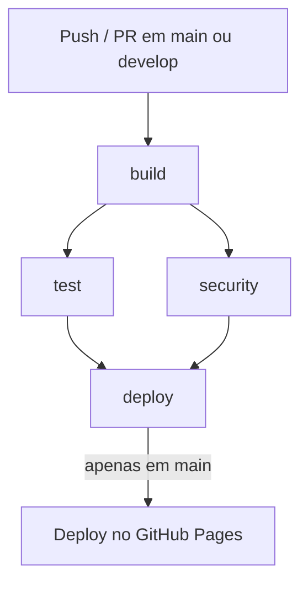

# Calculadora de IMC

Página web estática com lógica em JavaScript testável, publicada automaticamente no GitHub Pages por uma pipeline CI/CD.

## Pré-requisitos

- Node.js 20 LTS (ou superior)
- npm (vem com o Node.js)
- Git
- Navegador web moderno

## Instalação

1. Clone o repositório:
```bash
git clone https://github.com/seu- usuario/imc-calculator.git
cd imc-calculator
```

2. Instale as dependências:
```bash
npm install
```

3. Execute os testes:
```bash
npm test
```

4. Execute o build (gera a pasta `dist/`):
```bash
npm run build
```

## Uso

### Testes unitários
```bash
npm test
```

### Build
```bash
npm run build
```

O comando copia os arquivos de `public/` e `src/imc.js` para a pasta `dist/`.

### Visualização local
Após o build, abra o arquivo `dist/index.html` em um navegador ou sirva localmente:
```bash
cd dist && python3 -m http.server 8000
```
Acesse `http://localhost:8000`.

### Deploy automático
Ao fazer merge na branch `main`, a pipeline CI/CD é acionada e publica o site automaticamente no GitHub Pages.

## Fluxo Gitflow

- `main` — branch de produção, aciona o deploy.
- `develop` — branch de integração, onde as features são mergeadas.
- `feature/*` — branches para novas funcionalidades.

Exemplo de fluxo:
1. Crie uma branch `feature/nova-feature` a partir de `develop`.
2. Desenvolva, commite com mensagens convencionais (`feat:`, `fix:`, etc.) e envie.
3. Abra um Pull Request para `develop`.
4. Após o merge em `develop`, abra um PR para `main` — o deploy é acionado automaticamente.

## Pipeline CI/CD

A pipeline é definida em `.github/workflows/pipeline.yml` e possui os seguintes jobs:

1. **build** — instala dependências, gera a pasta `dist/` e publica como artifact.
2. **test** — depende do `build` e executa os testes com Jest.
3. **security** — depende do `build` (paralelo a `test`) e executa `npm audit --level=high`.
4. **deploy** — depende de `test` e `security`, roda apenas em `main` e faz deploy no GitHub Pages.

Se `test` ou `security` falharem, o job `deploy` é pulado (skipped), bloqueando a publicação.



## Status

[](https://github.com/seu- usuario/imc-calculator/actions/workflows/pipeline.yml)

## Site publicado

Acesse a versão live do projeto em: <https://seu- usuario.github.io/imc-calculator>